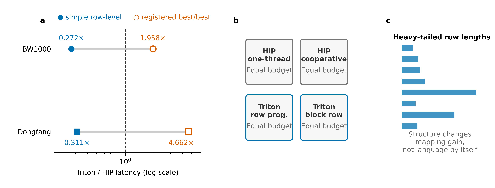
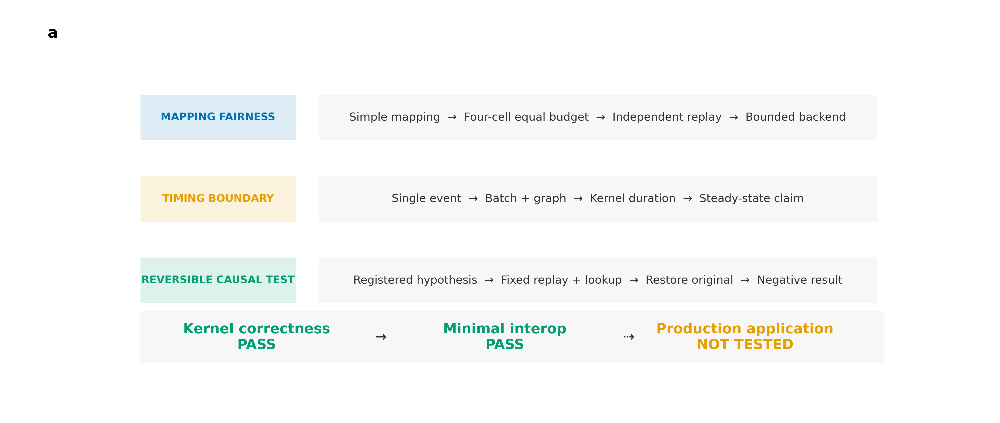
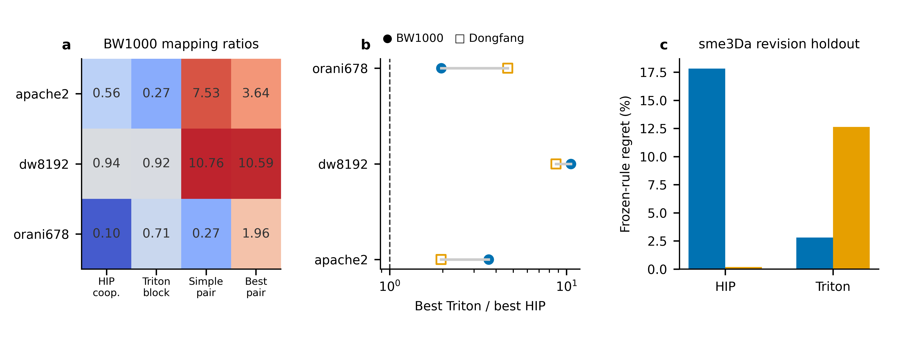
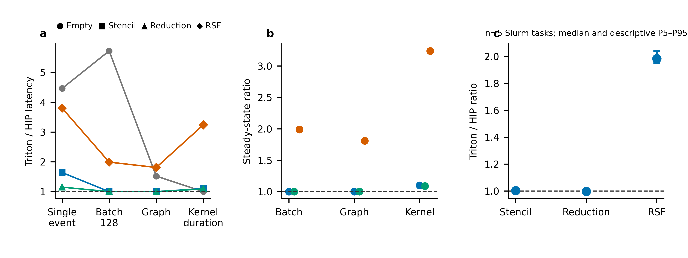
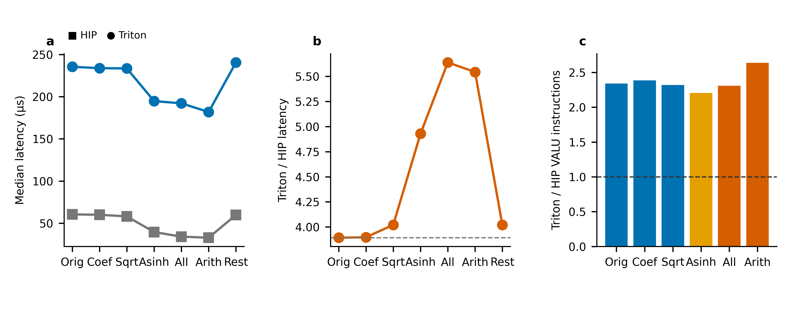
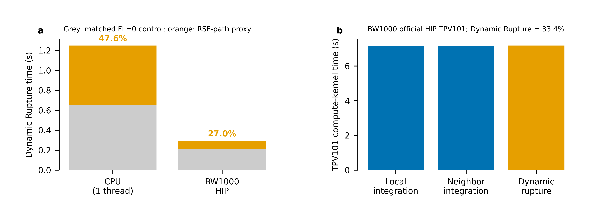
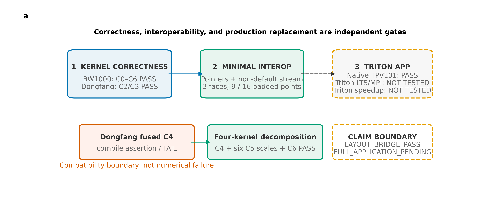

# 国产 DCU 科学计算内核的可审计 Triton/HIP 评测：映射、计时语义与可逆归因

**作者：** 李李李，李彪彪，冯德德  
**单位：** 中国计算机研究中心（英文单位名、所在城市及邮政编码待确认）  
**通信作者及电子邮箱：** 李李李，23342423@cnic.cn  
**中图分类号、文献标志码：** 待编辑部与作者按投稿系统填写

## 摘要

高层 GPU 内核语言能降低并行算子的表达成本，但其与原生后端的相对效率容易受到基线实现、映射策略和计时边界的共同影响。本文以两种国产 DCU 平台栈上的 FP64 stencil、reduction、稀疏矩阵向量乘和 SeisSol Aging 速率—状态摩擦迭代为对象，构建包含独立数值参考、同预算映射候选、七层计时、独立作业复测与可逆干预的 Triton/HIP 评测协议。结果表明：在简单映射下，重尾矩阵 `orani678` 呈现 Triton 优势；加入两端对称候选后，登记候选空间内 best Triton/best HIP 在 BW1000 和东方平台栈分别变为 1.958 和 4.662，原结论发生逆转。对大规模规则 stencil 与 reduction，五个独立作业的稳态 Triton/HIP 比值分别为 1.0021（P5—P95：0.9965—1.0035）和 0.9963（0.9952—0.9964）；这些是描述性观测，不构成统计等效性检验。RSF-C3 在 batch 独立作业中仍保持 1.9836 倍差距；固定实际迭代并移除超越函数后差距未缩小，否定了迭代数或超越函数存在本身这一单因素解释。官方 BW1000 HIP 的 2 s TPV101 基线中，Dynamic Rupture 占 compute-kernel 时间 33.4%，但该结果只是应用背景，不是 Triton 应用路径。研究说明，在受测平台栈和登记候选范围内，可信的后端选择需要同时约束映射候选、计时语义和可逆归因；SeisSol 仅用于检验这些独立内核结论与 TPV101 应用背景之间的边界。

**关键词：** 国产 DCU；Triton；HIP；科学计算；公平性能评测；速率—状态摩擦；SeisSol

## Auditable Triton/HIP Evaluation of Scientific Computing Kernels on Domestic DCUs: Mapping, Timing Semantics, and Reversible Attribution

**Authors and affiliation:** Li Li Li, Biaobiao Li, Dede Feng; China Computer Research Center (official English name, city and postal code to be confirmed)  
**Corresponding author:** Li Li Li, 23342423@cnic.cn

### Abstract

High-level GPU kernel languages reduce implementation effort, but their measured efficiency relative to native backends can change with baseline mappings and timing boundaries. We evaluate FP64 stencil, reduction, sparse matrix-vector multiplication, and SeisSol Aging rate-and-state friction kernels on two domestic DCU software stacks. The protocol combines an independent numerical reference, equal-budget mapping candidates, seven timing boundaries, independent job-level replication, and reversible interventions. Under simple row mappings, the heavy-tailed `orani678` matrix appears to favor Triton. After symmetric mapping search, however, the best-Triton-to-best-HIP ratios become 1.958 and 4.662 on the BW1000 and Dongfang stacks, respectively, reversing the earlier interpretation within the registered candidate space. Across five independent jobs, the steady-state ratios are 1.0021 (P5–P95, 0.9965–1.0035) for a large stencil and 0.9963 (0.9952–0.9964) for reduction; these are descriptive observations, not equivalence tests. RSF-C3 retains a 1.9836× batch gap across independent jobs. Fixing actual iteration traces and removing transcendental paths does not reduce this gap, rejecting iteration count and transcendental presence as sufficient single-factor explanations. In an official 2 s BW1000 HIP TPV101 baseline, Dynamic Rupture accounts for 33.4% of compute-kernel time; this provides application context rather than a Triton application result. These results show that defensible backend selection on the tested stacks must jointly specify the registered mapping space, timing semantics, and reversible attribution. SeisSol is retained as the source of the official RSF semantics and TPV101 context, not as a claimed production integration.

**Keywords:** domestic DCU; Triton; HIP; scientific computing; fair performance evaluation; rate-and-state friction; SeisSol

## 1 引言

Triton 以 program instance 和 tile 为主要抽象，使开发者能够用较高层的张量表达描述图形处理器（graphics processing unit，GPU）内核，并由编译器完成线程级映射与代码生成[1]。本文将国产通用计算设备称为 DCU，将 HIP（Heterogeneous-compute Interface for Portability）作为原生编程后端；将面向特定领域的语言记为 DSL，将高性能计算记为 HPC。这种方式有利于快速构建算子，但“能够正确运行”“某一计时口径下更快”与“可以替换生产后端”是三类不同判断。近期对 NVIDIA 平台上 HPC 算子和现代 GPU DSL 的研究也发现，规则性、计算强度和基线质量会显著改变性能评价，正确实现仍可能与高质量基线存在较大差距[2-4]。因此，后端比较若没有限定映射候选、计时语义和正确性合同，所得倍率很难直接转化为工程选择。

本文研究起点来自一个可重复的结论反转。在正式复核合同中，固定 Triton block-row 与 HIP one-thread-per-row 简单映射时，长尾稀疏矩阵 `orani678` 的 Triton/HIP 延迟比在 BW1000 和东方平台栈上分别为 0.272 和 0.311，表面上支持 Triton。为两端加入相同调优预算的 cooperative-row、block-row 等候选后，登记候选空间内 best Triton/best HIP 分别变为 1.958 和 4.662，后端胜负反转。该例说明，稀疏结构首先作用于 program-to-row 映射收益；若一端的基线缺少适合重尾行长的映射，比较实际测到的是“后端与映射”的组合，而非语言标签的固有效率。下文将稀疏矩阵向量乘记为 SpMV，将速率—状态摩擦记为 RSF；二者分别代表结构不规则与非线性迭代工作量。

**图1  登记候选改变 `orani678` 的后端结论。** 图内四个数值统一来自正式复核合同：BW1000 为五个独立作业的中位数，东方为冻结后的正式重放。简单映射与 best-vs-best 属于不同映射合同；后者只表示登记候选空间内的结果，不代表厂商库或全局最优。探索阶段的 BW1000 旧汇总值 0.186 不进入本图或主叙事。

现有工作分别提供了本文所需的基础认识：Roofline 和性能可移植性研究强调效率基准、平台集合与问题定义必须明确[5-6]；Kokkos、RAJA、Halide 和 Devito 表明高层抽象仍需要目标相关的布局或调度[7-10]；GPU SpMV 的性能依赖稀疏结构、存储格式和线程分配，并已有可复用的标准矩阵集合[11-12]。SeisSol 已有生成内核、融合 batched GEMM 和多后端加速的生产实践[13-14]，而速率—状态摩擦模型具有历史状态和非线性求解特征[15-17]。截至 2026-10-16 的限定检索中，尚未发现同时覆盖双国产 DCU 栈、同源 Triton/HIP 对称调优、多类 FP64 科学算子、Aging-RSF 可逆消融及分级应用门禁的公开研究。该陈述描述组合场景，不构成“首次”或“唯一”的断言。

据此，本文回答三个问题：RQ1，在登记候选空间内，对称映射候选和调优预算如何改变 Triton/HIP 结论；RQ2，不同计时边界如何改变同一算子的性能解释；RQ3，可逆干预能排除哪些关于 RSF 非线性内核差距的单因素解释，以及这些独立内核证据在 TPV101 应用背景中的适用边界是什么。本文贡献如下。

1. 提出登记候选空间内的公平映射合同：独立 FP64 reference、对称候选预算、冻结规则、失败记录和作业级重复共同限定后端比较；`orani678` 的胜负反转表明简单基线会把映射收益误读为语言收益。
2. 建立分层计时语义，将首次调用、host、single-event、batch、graph 与 profiler kernel duration 分开报告；规则算子的作业级比值接近 1，但不据此声称统计等效。
3. 对官方 Aging-RSF 语义执行可逆干预，证明实际迭代数与超越函数的存在均不足以单独解释剩余差距；TPV101 仅提供应用成本背景，完整 SeisSol Triton 生产接入不属于本文贡献。

**图2  研究设计与证据合同。** 映射公平性、计时边界和可逆因果干预形成三个闭环，随后进入独立的应用迁移门禁。BW1000 提供主要机制证据，东方平台栈用于检验关键方向是否复现；本文不据此构造严格的跨平台性能可移植性分数。

## 2 背景与相关工作

### 2.1 GPU DSL 与科学计算算子

Triton 的编译抽象最初面向规则张量计算，通过块级程序描述和自动代码生成减轻 CUDA 风格低层编程负担[1]。Chen 和 Xia 在 RTX 3090 上比较了 stencil、SpMV、GEMM 与 N-body，指出 Triton 对结构和计算强度的响应不同[2]。Ewart 和 Araya-Polo 的 2026 年预印本比较了多厂商高阶 stencil，并以存储层次和 Roofline 分析实现差异[3]；Li 等的同期预印本则从现代 DSL 的正确性与替换质量差距出发，提出仅通过 correctness 不能推出高性能[4]。这些结果为“correct but slow”问题提供了直接背景，但其平台、算子和基线与本文不同，不能代替国产 DCU 上的实测。

性能可移植框架通常通过显式执行空间、数据布局或调度策略，把算法表达与目标相关优化分离。Kokkos、RAJA、Halide 和 Devito 分别展示了多核/众核抽象、可移植循环策略、算法—schedule 分离和自动 stencil 生成[7-10]。这类工作说明高层表达并不会消除目标相关选择。本文进一步把这一认识转化为后端比较的操作性约束：两端需要得到相同数量级的 mapping 候选和调优预算，并在正确性过滤后比较各自最佳候选。

### 2.2 SpMV、计时边界与性能模型

SpMV 的行长分布、内存访问和负载均衡共同决定线程映射收益。Bell 和 Garland 系统讨论了吞吐处理器上的格式与线程分配[11]，SuiteSparse Matrix Collection 为矩阵结构研究提供了可复用输入[12]。本文从该集合选取调优与正式评测矩阵[22-27]，不把有限样本解释为完整矩阵总体。

Roofline 以算术强度连接带宽和计算 ceiling[5]，适合对设备侧限制进行分类，却不包含 JIT、主机提交、event、graph replay 和间接访问等完整调用路径。类似地，性能可移植性指标要求显式指定平台集合、问题和效率基准[6]。本文两个平台的软件版本没有对齐，因此只在各平台内计算比值，并用第二平台检验关系方向，不计算严格的性能可移植性单值。

### 2.3 SeisSol 与 Aging-RSF 迁移

SeisSol 的 GPU 路径已展示生成代码、融合 GEMM 和减少中间数据移动对生产应用的重要性[13]，相关历史资料也记录了 CUDA、HIP 与 SYCL 路径的工程背景[14,18-21]。Aging 速率—状态摩擦包含状态历史、非线性关系和迭代更新，参数选择还会影响破裂形态[15-16]；其他 GPU 地震周期模拟表明，全应用热点可能位于更高层求解过程，而非某个局部摩擦内核[17]。因此，独立 RSF 内核的正确性或性能不能直接外推为 SeisSol 应用收益。本文把迁移证据拆为数值内核、最小互操作和生产生命周期三个门禁。

## 3 实验设计

### 3.1 平台与证据边界

BW1000 为主机制平台，受测环境使用 gfx936、DTK 26.04 构建和 Triton 3.5.0；东方为第二平台栈，使用 gfx906、Triton 2.1/DTK 24.04 runtime 与 DTK 26 native 组合。两平台均在同一设备、同一输入和各自软件栈内完成 HIP/Triton 配对。软件栈差异使跨平台绝对倍率不具备硬件单因素解释条件；东方结果只用于验证映射效应、干预方向和迁移边界。

| 平台角色 | 设备架构 | Triton/runtime | HIP native 工具链 | FP64 与比较边界 |
|---|---|---|---|---|
| BW1000，主机制平台 | `gfx936` | Triton 3.5.0；DTK 26.04 runtime | DTK 26.04 | 同卡 FP64 配对；正式性能与 profiler 分作业；BW1000 结论仅来自本机实测 |
| 东方，方向复核平台 | `gfx906` | Triton 2.1；DTK 24.04 runtime | DTK 26 native | 同卡 FP64 配对；软件栈与 BW1000 不同，只比较结论方向，不比较绝对硬件能力 |

**表1  平台配置与跨平台限制。** 完整模块、环境变量、设备信息、编译参数和作业标识见补充材料；未在目标平台实测的能力保持 `NOT_TESTED`。

### 3.2 算子与正确性合同

实验覆盖四类 FP64 工作量：规则 stencil、行归约、CSR SpMV 以及 Aging-RSF C3/Newton 更新。每个正式候选先与独立 CPU binary64 reference 比较，并检查边界、非有限值、收敛标志、迭代数和诊断字段。SpMV 候选若未通过 reference 即从性能账本剔除。RSF 可逆消融的物理 lookup 版本与冻结轨迹 reference 对齐；普通算术占位另用独立标量 reference，不与物理输出混作正确性证据。

### 3.3 对称映射与冻结调优

HIP 候选包含 one-thread-per-row 与 cooperative-row，Triton 候选包含 row-program 与 block-row；block size、group 或 warp 参数由两平台各自的 96 个逻辑候选账本确定。调优集为 `bcsstk17` 和 `poisson3Da`[22-23]，冻结后在 `dw8192`、`apache2`、`orani678` 上比较四格实现，并在 `sme3Da` 上执行一次 48 候选 revision holdout。该 holdout 曾用于早期探索，故不能称为 pristine holdout；结果也不反向修改冻结规则。

这里的“公平”是程序性的：语义相同、候选预算对称、正确性门槛一致、冻结和 tie-break 可追溯。cooperative-row 与 block-row 并非指令级同构，有限候选也不能证明全局最优；登记 HIP 内核更不等同厂商库最优实现。

### 3.4 七层计时与统计单位

计时协议分离首次调用、JIT/AOT 后 host submit-to-sync、single device-event、连续 batch=128 单次值、graph replay、profiler dispatch 和 profiler kernel duration。empty kernel 作为调用路径 control。正式 latency 使用无 profiler 的 device event；profiler 时间线只交叉核查设备 kernel 区间，不参与 speedup。graph 只验证当前固定地址调用可捕获，不代表完整 SeisSol 可捕获。

独立性以 Slurm 作业为单位。五个独立任务分别经历冷启动、correctness、warmup 和稳态测量，奇偶任务交替 HIP-first/Triton-first；每个任务内部的 30 次或 batch 调用只用于形成任务内中位数，不作为独立重复。本文报告五任务中位数和 P5—P95，仅描述当前作业级稳定性。任务级中位数、顺序、冻结候选账本、tie-break 与原始目录索引见补充材料 SM1—SM5。

### 3.5 RSF 可逆干预与迁移门禁

RSF 机制实验先固定实际迭代轨迹，再依次以 lookup 替换 coefficient 中的 `log+exp`、`sqrt`、asinh 路径、全部超越函数，并设置普通算术占位，最后恢复原实现。预登记判断为：若某因素的存在是相对差距的主要解释，移除后 Triton/HIP 比值应缩小；原实现恢复值必须在 ±10% 门槛内。PMC 独立采集 `SQ_INSTS_VALU`，仅作为方向性线索。

应用迁移设置三个门禁：Kernel 检查 C0—C6 数值和重复稳定性；Interop 检查外部 device pointer、非默认 stream 和 face×padded 布局；Production 检查真实 `LTSRateAndState`、SYCL queue、auxiliary memory、MPI/LTS 生命周期、TPV101 路径及端到端时间。前一门禁通过不自动推出后一门禁通过。

## 4 实验结果

### 4.1 映射公平性改变 SpMV 结论

BW1000 上 96 个逻辑候选全部通过 reference。五个独立作业中，HIP cooperative-row/one-thread-per-row 延迟比在 `dw8192`、`apache2` 和 `orani678` 上分别为 0.941、0.557 和 0.097；Triton block-row/row-program 分别为 0.916、0.269 和 0.710。两种后端的 mapping 收益均随矩阵结构变化，且变化方向并不一致。

在各后端从冻结候选中取最佳实现后，BW1000 的 best Triton/best HIP 在 `dw8192`、`apache2` 和 `orani678` 上分别为 10.589、3.635 和 1.958，五个作业方向一致，描述性 P5—P95 分别为 9.590—10.676、3.565—3.640 和 1.792—1.988。东方独立调优得到 8.721、1.952 和 4.662，方向与 BW1000 相同。特别是 `orani678` 从简单 row-level 比较中的 Triton 胜出变为 best-vs-best 中 HIP 胜出，说明旧反转主要暴露 one-thread-per-row 对重尾行长的负载不均，而不足以证明 Triton 后端整体占优。

**图3  对称候选空间下的 SpMV 映射收益与 revision holdout。** 比值大于 1 表示 Triton 较慢。相同候选预算是一种操作性公平定义，不意味着低层指令同构或厂商库最优。

冻结默认在 `sme3Da` 上未同时命中两端 top-1。BW1000 的 HIP/Triton regret 为 17.81%/2.80%，东方为 0.19%/12.63%。后端间 regret 排序跨平台改变，表明两个 tuning 矩阵形成的常数默认不足以建立可靠结构阈值。本文因此把贡献限定为公平比较协议和 baseline 反转证据，不提出自动 mapping 选择器。

### 4.2 计时边界改变规则算子的性能解释

empty control 的 single-event 延迟在 Triton/HIP 上为 32.80/7.36 μs，比值 4.46；profiler kernel duration 却均为 0.64 μs。因 empty kernel 不包含有效算术和数据访问，这一差异不能归于内核计算本身，说明 event 区间覆盖了后端相关的提交或事件路径。graph replay 后比值降为 1.52，但 graph 与 single-call 表示不同使用场景，不能用一个边界替代另一个。

大规模 interior stencil 的 Triton/HIP 比值从 single-event 的 1.64 降到 batch 和 graph 的 1.00/1.00，profiler kernel duration 为 1.10；row reduction 从 1.15 降到 1.00/1.00，kernel duration 为 1.09。五个独立作业进一步得到 stencil 1.0021 [P5 0.9965，P95 1.0035]，reduction 0.9963 [0.9952，0.9964]。后者虽方向一致，但效应不足 0.5%。由于未预设等效界值，也未执行形式等效检验，本文只将两者表述为五个受测作业中接近 1 的描述性比值，不作总体或工程等效判断。

**图4  七层计时与独立作业复核。** single-event、batch、graph 和 profiler kernel duration 是不同计时语义，不能相减为唯一 overhead。规则大算子在稳态边界接近，RSF-C3 则保留稳定差距。

这些结果回答了 RQ2 的第一部分：single-event 对单次响应仍有工程意义，但不能单独作为纯 kernel 效率代理；存在连续调用或固定地址可捕获条件时，大规则算子的相对差距会显著收敛。该结论不外推到所有规则算子，也不说明完整 SeisSol 能通过 graph 消除调用成本。

### 4.3 RSF-C3 的稳定差距

RSF-C3 与规则算子的表现不同。在 n=65537、batch=128 的五个独立作业中，Triton/HIP 比值中位数为 1.9836，P5—P95 为 1.9500—2.0405，且五个任务方向一致。profiler kernel duration 为 182.72/56.32 μs，比值 3.24。batch 与 profiler 数字属于不同协议，不能平均，但它们共同说明 RSF 差距不能只由单次 Python 提交解释。五个任务级输入和原始目录索引见补充材料 SM1。

固定实际迭代轨迹后，HIP/Triton 为 57.12/224.08 μs；紧邻恢复为 57.28/225.44 μs，比值没有缩小。这排除了实际迭代轨迹及该冻结协议下路径差异作为相对差距的充分单因素解释；它不单独隔离动态收敛控制流、谓词化或 lowering 成本。干预闭环的输出通过独立 reference，恢复也满足预登记的 ±10% 门槛。

### 4.4 可逆消融否定超越函数单因素解释

函数路径消融给出负面因果结果。固定原实现的 Triton/HIP 比值约为 3.89—4.02；lookup asinh 使 HIP 和 Triton 分别降至 39.52 和 194.80 μs，但比值扩大到 4.93；lookup 全部超越函数进一步降至 34.08 和 192.16 μs，比值扩大到 5.64。普通算术占位的比值为 5.54。也就是说，超越函数对两端绝对成本均有贡献，但移除它们没有产生预登记的“相对差距缩小”响应，反而让 HIP 获益更多。

**图5  RSF-C3 可逆消融与方向复现。** 性能比值来自冻结的 fixed-replay 消融协议；PMC 时间不进入 speedup。函数替换同时会改变生成代码的多种属性，故该图只检验预登记的单因素方向，不定位编译器根因。东方仅用于验证“移除函数后差距不缩小”的干预方向，不与 BW1000 拼接绝对倍率。

独立 PMC 显示，原始 fixed replay、lookup coefficient、sqrt、asinh、全部函数和算术占位的 Triton/HIP `SQ_INSTS_VALU` 比分别为 2.34、2.38、2.32、2.21、2.31 和 2.64。该观察与“剩余差距来自更宽的循环、逐 lane 控制、算术与 lowering 组合”相容，但计数器不能区分谓词化、重复计算、指令选择或代码体积，因而不足以定位唯一根因。东方在相同冻结干预下得到 lookup asinh 5.37、lookup all 5.63，并同样观察到两端加速而比值不缩小，为负面因果方向提供第二平台栈证据。

### 4.5 第二平台的有限外部有效性

东方平台栈复现了两项关键关系：对称 mapping 消除了 `orani678` 简单 baseline 中的 Triton 胜出；移除 RSF 函数路径没有缩小跨后端差距。它还暴露了旧 Triton/MLIR 在 fused C4 形态上的编译边界。由于平台使用的 Triton、runtime 与 native 编译栈未完全对齐，本文不比较两个平台的绝对延迟，不将倍率差异归因于硬件，也不声称获得了严格性能可移植性指标。

## 5 SeisSol 案例：从独立内核到生产路径

为检验 RSF 微内核研究是否位于真实应用路径，补充执行了官方 TPV101 应用基线。BW1000 `gfx936` 官方 HIP/AdaptiveCpp 后端已完成 2 s TPV101 运行；其内置计时中 `computeLocalIntegration`、`computeNeighboringIntegration` 和 `computeDynamicRupture` 分别为 7.13288、7.17273 和 7.18198 s，Dynamic Rupture 占总 compute-kernel 时间的 33.4%。在独立的匹配 `FL=3`/`FL=0` 对照中，Aging-RSF 路径的 Dynamic Rupture 时间近似贡献为 CPU 47.6%、BW1000 27.0%。该差值只说明摩擦律选择在应用路径中改变了成本，不是独立 RSF 函数的硬件计时，也不构成 Triton 应用加速。

**图6  官方 TPV101 应用上下文。** 左：匹配 `FL=3`/`FL=0` 对照给出 Aging-RSF 路径的 Dynamic Rupture 时间近似贡献；右：BW1000 官方 HIP TPV101 的主要 compute-kernel 分类。两项测量分别用于工作负载动机与应用成本上下文，均不与独立 Triton C3 latency 相除。原始日志、构建审计和调用链证据见补充材料 SM7。

两平台的独立 RSF 路径均建立了 FP64 reference 证据。BW1000 的 C0—C6 全部通过；东方 fused C4 在六组 launch 映射上稳定触发旧 Triton/MLIR `TypeRange` 断言。保持数学语义的 state update、C3、outer accumulate 和 final diagnostic 四内核分解随后通过 C4、六种 C5 规模和 C6 的 100 次重复。因此，fused failure 是特定软件栈与实现形态的编译兼容边界，不是数值不一致。

**图7  SeisSol 三级迁移门禁。** 官方 HIP TPV101 应用基线、Kernel 与最小 Interop 已有通过证据；Triton 的真实 LTS/MPI 生命周期及应用加速保持 `FULL_APPLICATION_PENDING/NOT_TESTED`。fused 编译失败后的四内核分解只证明语义保持的兼容路径，不等于生产后端接入。

最小互操作门禁由 C++ 创建 17 个外部 device buffer 和非默认 HIP stream，经嵌入式 Python/Triton 处理 face×padded 布局。速度、摩擦、残差、迭代数和收敛标志均零失败，东方最大绝对误差为 1.6965×10^-16。测试过程中保留的三次 ABI 失败表明 launcher 对象需要同时提供 `data_ptr()` 与 `dtype`；该失败链也说明数学正确的 kernel 仍可能在指针类型、stream 顺序和布局接口处失效。

Production 门禁尚未通过。真实 `LTSRateAndState`、SYCL queue、auxiliary memory、MPI/LTS 生命周期、TPV101 Triton 调用路径和端到端 speedup 均为 `NOT_TESTED`。对 SeisSol v1.3.2-git-v2 的静态审计已定位 `GpuImpl/BaseFrictionSolver.h::evaluate` 的队列同步与 LTS 数据复制边界、`GpuImpl/RateAndState.h::updateFrictionAndSlip` 的多阶段 RSF 更新，以及 face×`misc::NumPaddedPoints` 的设备布局；但这些源码定位和官方 HIP TPV101 运行仅证明 native 应用基线及接入难点，未执行 Triton 替换。最小 bridge 没有覆盖这些未测条件。因此，当前状态只能写作 `LAYOUT_BRIDGE_PASS / FULL_APPLICATION_PENDING`，不能写成 SeisSol Triton 后端已完成或获得应用级加速。静态审计和构建/运行证据见 SM7；官方文档[18-21]仅用作软件背景。

## 6 讨论

### 6.1 公平评测的最低合同

实验表明，科学计算双后端比较至少需要四项合同。第一，同一数学语义和独立 reference，防止“更快”来自语义缺失。第二，对称候选预算和公开账本，防止某一后端仅因缺少合适 mapping 而失分。第三，多计时边界，分别回答冷启动、单次响应、稳态吞吐与纯 kernel 区间问题。第四，独立作业和失败证据，避免把进程内调用当作独立重复，并保留协议修正过程。该合同不能保证全局最优，但能够阻止简单 baseline 被误写为后端固有能力。

### 6.2 条件化的后端选择

对大规模规则 stencil 和 reduction，五个受测作业的稳态比值接近 1；这支持把 Triton 纳入后续工程候选，但不构成等效性判定。若关注单次小 kernel 响应，则应显式计入事件和调用路径。对 SpMV，应先依据输入结构评估 cooperative、block-row 等 mapping，不能由“规则/不规则”标签直接选择语言。对当前 RSF-C3，batch 和 kernel timeline 均保留明显差距，在剩余机制未分离前应保留 HIP baseline。

### 6.3 负面结果与机制证据

RSF 消融没有给出唯一根因，却提高了机制结论的可信度。固定实际迭代和函数移除均未使差距按预登记方向缩小，因此两个直观解释不再适合作为主要原因。剩余搜索可以集中于固定上限循环、逐 lane predicate、除法与选择指令、代码体积和后端 lowering 的组合。Roofline 或 PMC 可以帮助确定检查方向，但只有冻结干预、恢复和 reference 才能把相关观察提升为可证伪的机制检验。

### 6.4 与相邻工作的关系

本文不重复声称 SpMV 结构敏感性或目标相关调度是新现象[7-12]，也不把两个软件栈的趋势复现解释为普适性能可移植性[6]。相对于 NVIDIA 上的 Triton/HPC 比较和多厂商 stencil 预印本[2-4]，本文的增量在于把 baseline 公平性、分层计时、负面可逆消融和应用迁移门禁放入同一证据架构。相对于 SeisSol 已完成的融合与生产加速工作[13]，本文提供的是 RSF 局部后端迁移成熟度的有界评估，而非新的完整应用后端。

| 最近邻工作族 | 已有覆盖 | 本文新增证据 | 改变的研究决策 |
|---|---|---|---|
| Triton/HPC 算子比较[2-3] | NVIDIA 平台上的规则性、计算强度与基线差异 | 双国产 DCU 栈；同预算四格映射；作业级胜负反转 | 先冻结候选空间，再解释语言/后端排序 |
| 多后端 stencil 与性能可移植性[4,6] | 多平台趋势与可移植性度量 | 七层计时把 single-event、稳态吞吐和 kernel duration 分开 | 不用单一 event 倍率代表纯 kernel 效率或严格可移植性 |
| GPU SpMV 方法[11-12] | 稀疏结构、格式和线程分配影响性能 | `orani678` 在简单映射与登记 best-vs-best 下结论反转 | 把映射族作为公平基线的一部分，而非后验优化细节 |
| SeisSol 生成与融合内核[13-14] | 生产代码生成、融合 batched GEMM 和应用集成 | 官方 Aging-RSF 语义上的可逆负面消融与 TPV101 应用边界 | 保留独立内核结论，不把它外推为生产后端或应用加速 |

**表2  最近邻工作与本文决策增量。** “新增”指当前证据包中的组合式、可复核增量，不构成“首次”或普适性声明。

## 7 有效性威胁与局限

**候选空间。** SpMV 映射并非指令级同构，有限候选只能建立登记预算内的程序公平，不能证明全局最优或厂商库水平。矩阵数量有限，`sme3Da` 还是 revision holdout，不能支持普适结构阈值。

**平台与统计。** 两个平台的软件栈未对齐，实验以单卡、有限作业数为主；跨平台只比较关系方向。五个作业的区间是描述性稳定性证据，不代表广泛设备总体，也未进行形式统计等效检验。

**计时与机制。** device event、batch、graph 和 profiler 各自包含不同边界，profiler 还可能扰动执行。PMC/ISA 只提供方向性线索，不能单独证明编译器根因。RSF lookup 与 placeholder 会同时改变调度、代码体积和常量传播，本文的因果结论只是否定预登记的强单因素假设。

**应用覆盖。** 最小 bridge 没有覆盖真实 SeisSol 的 LTS、MPI、SYCL queue、辅助内存和异常生命周期，不能支持端到端性能结论。完整生产路径保持 `NOT_TESTED`。

**文献与完整性。** 当前定向文献检索和书目信息核验已形成候选集，但作者既往发表排重及部分来源语义核验尚未闭合；本文不据此声明已达到投稿就绪状态。

## 8 结论

本文在两个国产 DCU 平台栈上评估了 Triton 与 HIP 的科学计算内核。对 RQ1，登记空间内的对称候选预算使 SpMV 的表面胜负发生反转，说明输入结构通过 mapping 收益影响结论。对 RQ2，分层计时显示五个受测作业中的大规则算子稳态比值接近 1，但该观察不等同于形式等效。对 RQ3，固定迭代与函数路径的可逆干预排除了实际迭代数和超越函数存在本身作为 RSF 差距的充分单因素解释。SeisSol 在本文中提供官方 Aging-RSF 语义与 TPV101 应用背景；完整生产生命周期和应用级 Triton 加速不在本文声称范围内。由此，受测平台栈上的后端选择应联合声明映射候选、计时语义和干预边界，不能由语言标签或单一倍率推断。

## 数据与代码可用性

本文实验脚本、冻结协议、结构化结果、任务级日志、失败记录、内核源码、图件源数据和版本信息已公开于 https://github.com/ShuaibiaoLi/rsf-triton-evaluation-artifact ，冻结版本为 `v1.0.1`。代码采用 MIT License，数据、图件与文档采用 CC BY 4.0。补充材料 SM1—SM8 的文件清单见 `supplementary_materials_index.md`。本公开仓库不是匿名审稿入口，目前尚无 DOI；涉及平台访问限制的第三方材料不在本包内重新授权。

## 伦理声明

本研究不涉及人类参与者、人体样本、个人可识别信息或动物实验。

## 作者贡献（CRediT）

李李李：Project administration、Writing—review & editing；李彪彪：Conceptualization、Methodology、Software、Validation、Formal analysis、Investigation、Data curation、Visualization、Writing—original draft；冯德德：Supervision、Writing—review & editing。李李李同时担任通信作者。全体作者审阅并同意论文最终版本。

## 利益冲突

作者声明不存在利益冲突。

## 基金项目

本研究获得国家自然科学基金资助（项目编号：34563；基金标准名称和编号须在投稿前按批件复核）。

## AI 使用披露

本稿在作者监督下使用生成式人工智能工具辅助整理项目内实验材料、构建论文结构、生成初稿文字和绘图代码。所有实验数据、数值结论、参考文献和最终表述须由作者依据原始记录逐项核验；人工智能工具不列为作者，也不承担研究责任。投稿时将依据《计算机工程与科学》的最新政策调整披露文字。

## 附录A 主要实验结论的证据索引

| 结论族 | 作业或证据单元 | 归档报告/结构化结果 |
|---|---|---|
| BW1000 SpMV 对称候选与独立作业 | 924088、924300、924336_[0-4]、924488 | `docs/reports/spmv_four_cell_revision_v1.md`；`results/bw1000/revision_v1/formal/spmv-four-cell-independent-jobs-v1.json` |
| 东方 SpMV 方向复现与 holdout | 22427200、22431674、22431696 | `docs/reports/dongfang_spmv_revision_v1.md`；`results/dongfang/revision_v1/` |
| 七层计时与 profiler timeline | 925680、925708、925715、925723 | `docs/reports/timing_decomposition_revision_v2.md`；`results/bw1000/revision_v1/timing/` |
| 非 SpMV 独立作业 | 925740_[0-4] | `docs/reports/nonspmv_independent_jobs_revision_v1.md`；`results/bw1000/revision_v1/formal/nonspmv-independent-jobs-v1.json` |
| RSF fixed replay、函数消融、PMC 与东方复现 | 925770、925877、925991、927685、22427075 | `docs/reports/rsf_c3_causal_ablation_revision_v2.md`；`results/{bw1000,dongfang}/revision_v1/ablation/` |
| RSF C4—C6 与最小互操作 | 22391310、22391312、22391368 及 BW1000 C0—C6 证据 | `docs/paper/rewrite_20261016/evidence_architecture.md` 所列最终报告与原始日志 |
| 官方 SeisSol TPV101 应用上下文 | BW1000 作业 866206；另含匹配 FL=3/FL=0 smoke 对照 | `BW1000_test/seissol-source/evidence/866206/slurm-smoke-866206.out`；`docs/reports/seissol_rsf_hotspot_final_report_v1.md`；`docs/reports/seissol_hotspot_inventory_and_portability_stage_v1.md` |

注：内部作业号和工作区路径用于投稿前审计；匿名投稿或公开发布时应替换为可访问的匿名仓库、DOI 或补充材料编号。

## 参考文献

[1] TILLET P, KUNG H T, COX D. Triton: an intermediate language and compiler for tiled neural network computations[C]//Proceedings of the 3rd ACM SIGPLAN International Workshop on Machine Learning and Programming Languages. New York: ACM, 2019: 10-19. DOI: 10.1145/3315508.3329973.

[2] CHEN Y, XIA C. From naive CUDA to Triton: a systematic evaluation of AI-era HPC operator development[C]//Proceedings of the 40th ACM International Conference on Supercomputing Workshops. New York: ACM, 2026: 60-64. DOI: 10.1145/3774895.3812198.

[3] EWART T, ARAYA-POLO M. Stencil computation at the intersection of AI and HPC[EB/OL]. arXiv:2609.10368, 2026[2026-10-16]. https://arxiv.org/abs/2609.10368.

[4] LI T, RATHNASURIYA R, YANG W. Correct but slow: an empirical study of the GPU kernel evaluation gap in modern domain-specific languages[EB/OL]. arXiv:2607.04454, 2026[2026-10-16]. https://arxiv.org/abs/2607.04454.

[5] WILLIAMS S, WATERMAN A, PATTERSON D. Roofline: an insightful visual performance model for multicore architectures[J]. Communications of the ACM, 2009, 52(4): 65-76. DOI: 10.1145/1498765.1498785.

[6] PENNYCOOK S J, SEWALL J D, LEE V W. A metric for performance portability[C/OL]//Proceedings of the 7th International Workshop on Performance Modeling, Benchmarking and Simulation of High Performance Computer Systems. 2016[2026-10-16]. https://arxiv.org/abs/1611.07409.

[7] EDWARDS H C, TROTT C R, SUNDERLAND D. Kokkos: enabling manycore performance portability through polymorphic memory access patterns[J]. Journal of Parallel and Distributed Computing, 2014, 74(12): 3202-3216. DOI: 10.1016/j.jpdc.2014.07.003.

[8] BECKINGSALE D A, BURMARK J, HORNUNG R, et al. RAJA: portable performance for large-scale scientific applications[C]//2019 IEEE/ACM International Workshop on Performance, Portability and Productivity in HPC. Piscataway: IEEE, 2019: 71-81. DOI: 10.1109/P3HPC49587.2019.00012.

[9] RAGAN-KELLEY J, BARNES C, ADAMS A, et al. Halide: a language and compiler for optimizing parallelism, locality, and recomputation in image processing pipelines[C]//Proceedings of the 34th ACM SIGPLAN Conference on Programming Language Design and Implementation. New York: ACM, 2013: 519-530. DOI: 10.1145/2499370.2462176.

[10] LUPORINI F, LOUBOUTIN M, LANGE M, et al. Architecture and performance of Devito, a system for automated stencil computation[J]. ACM Transactions on Mathematical Software, 2020, 46(1): Article 6, 28 pages. DOI: 10.1145/3374916.

[11] BELL N, GARLAND M. Implementing sparse matrix-vector multiplication on throughput-oriented processors[C]//Proceedings of the Conference on High Performance Computing Networking, Storage and Analysis. New York: ACM, 2009: 1-11. DOI: 10.1145/1654059.1654078.

[12] DAVIS T A, HU Y. The University of Florida sparse matrix collection[J]. ACM Transactions on Mathematical Software, 2011, 38(1): Article 1, 25 pages. DOI: 10.1145/2049662.2049663.

[13] DOROZHINSKII R, GADESCHI G B, BADER M. Fused GEMMs towards an efficient GPU implementation of the ADER-DG method in SeisSol[J]. Concurrency and Computation: Practice and Experience, 2024, 36(12): e8037. DOI: 10.1002/cpe.8037.

[14] DOROZHINSKII R, BADER M. Combining CUDA and SYCL for accelerating earthquake simulations in SeisSol[P/OL]. PASC 2023, Davos, 2023[2026-10-16]. https://mediatum.ub.tum.de/doc/1729891/1729891.pdf.

[15] LIU S, BHATTACHARYA K, LAPUSTA N. Learning a potential formulation for rate-and-state friction[J]. Mechanics of Materials, 2026, 212: 105540. DOI: 10.1016/j.mechmat.2025.105540.

[16] WEI X, CHEN X. Diversity and transition of rupture styles governed by rate-and-state friction[J]. Geophysical Journal International, 2026, 246(1): ggag175. DOI: 10.1093/gji/ggag175.

[17] SUN X, ZHANG Z. A new finite-difference method for earthquake cycles accelerated by GPU and multigrid method[J]. Geophysical Journal International, 2025, 241(2): 1029-1041. DOI: 10.1093/gji/ggaf085.

[18] SEISSOL PROJECT. SeisSol with GPUs: version 1.3.0[EB/OL]. [2026-10-16]. https://seissol.readthedocs.io/en/v1.3.0/gpus.html.

[19] SEISSOL PROJECT. Dynamic rupture[EB/OL]. [2026-10-16]. https://seissol.readthedocs.io/en/latest/dynamic-rupture.html.

[20] SEISSOL PROJECT. Installing dependencies[EB/OL]. [2026-10-16]. https://seissol.readthedocs.io/en/latest/build-dependencies.html.

[21] SEISSOL PROJECT. Compiling and running SeisSol[EB/OL]. [2026-10-16]. https://seissol.readthedocs.io/en/latest/build-seissol.html.

[22] SUITESPARSE MATRIX COLLECTION. HB/bcsstk17[DB/OL]. [2026-10-16]. https://sparse.tamu.edu/HB/bcsstk17.

[23] SUITESPARSE MATRIX COLLECTION. FEMLAB/poisson3Da[DB/OL]. [2026-10-16]. https://sparse.tamu.edu/FEMLAB/poisson3Da.

[24] SUITESPARSE MATRIX COLLECTION. Bai/dw8192[DB/OL]. [2026-10-16]. https://sparse.tamu.edu/Bai/dw8192.

[25] SUITESPARSE MATRIX COLLECTION. GHS_psdef/apache2[DB/OL]. [2026-10-16]. https://sparse.tamu.edu/GHS_psdef/apache2.

[26] SUITESPARSE MATRIX COLLECTION. HB/orani678[DB/OL]. [2026-10-16]. https://sparse.tamu.edu/HB/orani678.

[27] SUITESPARSE MATRIX COLLECTION. FEMLAB/sme3Da[DB/OL]. [2026-10-16]. https://sparse.tamu.edu/FEMLAB/sme3Da.

